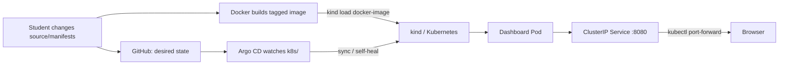

# GitOps-Based Continuous Deployment Using Argo CD and Kubernetes

A complete, beginner-friendly academic project: package a static dashboard with Docker, run it on local Kubernetes using kind, and let Argo CD reconcile Kubernetes manifests stored in Git.

> **Responsibility boundary:** Docker builds the image. Kubernetes runs it. Argo CD reads Git and reconciles Kubernetes resources; **Argo CD does not build Docker images**. For this self-contained kind demo, the image is loaded into kind before its tag is committed as the Deployment's desired state.

## Project objectives

- Understand Git as the versioned source of desired state.
- Package and serve a responsive static web app with Nginx.
- Use Kubernetes Deployments, probes, Services, and namespaces.
- Observe Argo CD synchronization and health separately.
- Reproduce a v1.0.0 → v2.0.0 release without inventing Git history.

The page's deployment-status panel is explicitly **static presentation metadata**, not live Kubernetes health. Use the CLI and Argo CD UI for actual cluster status.

## Architecture



In plain English: a pushed Git commit is the plan; Docker makes the app package; Argo CD watches the Kubernetes configuration; Kubernetes runs the image and exposes a Service. A local port-forward lets a browser reach that Service.

## Repository map

| Path | Purpose |
| --- | --- |
| `app/` | Dashboard HTML/CSS/JS and `version.json` loaded by the browser at runtime. |
| `docker/` | Nginx Alpine image and `/healthz` endpoint config. |
| `k8s/` | Namespace, one-replica Deployment, ClusterIP Service, and Kustomize entrypoint. |
| `argocd/application.yaml` | Argo CD Application template with an intentional repository URL placeholder. |
| `scripts/` | Prerequisite, cluster, install, image, deploy, verify, demo, cleanup, and v2 helper commands. |
| `docs/` | Architecture, setup, demo, screenshot, troubleshooting, validation, and presentation guides. |
| `Makefile` | Beginner-friendly command shortcuts. |

## Requirements and platform notes

For the end-to-end demo you need Bash, Git, Docker CLI **and a running Docker daemon**, kubectl, kind, Python 3, and Internet access for kind/Argo downloads. Python 3 safely renders the temporary Application manifest and powers the v2 helper. The optional `jq`, `yq`, ShellCheck, and `argocd` CLI improve convenience but are not required for deployment. The Nginx unprivileged Alpine base supports multiple architectures, including Apple Silicon.

- **macOS:** Docker Desktop, current kubectl and kind; allocate adequate memory to Docker Desktop.
- **Linux:** Docker Engine with daemon access, kubectl, and kind.
- **Windows:** Run Bash commands in WSL2 with Docker Desktop's WSL integration. Use your Windows browser for the forwarded localhost URL.

See [Setup](docs/SETUP.md) for official install links and platform-specific detail.

## Clone, push, and configure Git

Argo CD must be able to clone a **pushed** Git repository. It cannot sync the copy on your laptop. Create an empty GitHub repository (avoid initializing another README/license), configure `origin` if needed, and push the project to `main`:

```sh
git status --short --branch
git remote -v
git remote add origin https://github.com/OWNER/REPOSITORY.git  # only if origin is missing
git branch -M main
git push -u origin main
```

If `origin` already points to the intended repository, keep it. Configure the actual clone URL in your terminal (replace the owner and repo):

```sh
export GIT_REPO_URL=https://github.com/OWNER/REPOSITORY.git
```

The checked-in Argo CD template deliberately uses `https://github.com/REPLACE_WITH_OWNER/REPLACE_WITH_REPOSITORY.git`. The deploy script validates `GIT_REPO_URL`, renders a temporary Application manifest, applies it, and deletes the temporary file. It never mutates the tracked template or pushes Git. See [private repository access](docs/SETUP.md#private-repositories); never commit credentials.

## Run the v1.0.0 local demo

From the repository root:

```sh
make help
make check
make setup
export GIT_REPO_URL=https://github.com/OWNER/REPOSITORY.git
make deploy
make verify
```

`make check` performs static checks. `make setup` checks required tools, creates/reuses the `gitops-demo` kind cluster, then installs Argo CD from the official stable installation manifest. **Setup and deploy require Internet access** for kind node images and Argo CD manifests/images. Workload waits are bounded. `make deploy` builds and loads the image tag from `app/version.json`, idempotently installs Argo CD, and applies the Application template. It requires that GitHub has the repository and `k8s/` manifests at the configured ref; it does not claim the repository was pushed or can be fetched.

The default image is `gitops-demo-dashboard:v1.0.0`. Its tag is derived from `app/version.json`, and the Deployment uses `imagePullPolicy: Never`. `make deploy` builds and loads the exact image before applying the Application. To run those independent steps yourself (or use a custom tag), invoke:

```sh
scripts/build-image.sh
scripts/load-image.sh
```

### Open the dashboard

In a terminal, keep this command running:

```sh
kubectl --context kind-gitops-demo -n gitops-demo port-forward svc/gitops-demo-dashboard 8080:8080
```

Visit [http://localhost:8080](http://localhost:8080).

### Open Argo CD

In another terminal:

```sh
kubectl --context kind-gitops-demo -n argocd port-forward svc/argocd-server 8081:443
```

Visit [https://localhost:8081](https://localhost:8081), accept the local self-signed certificate warning, and sign in as `admin`. Retrieve the initial password only in a private terminal:

```sh
kubectl --context kind-gitops-demo -n argocd get secret argocd-initial-admin-secret \
  -o jsonpath='{.data.password}' | base64 -d; echo
```

Never publish the password, put it in Git, or include it in screenshots.

## Verify actual deployment

```sh
scripts/verify-deployment.sh
scripts/verify-deployment.sh --port-forward
```

The first checks the expected kind context, rollout, Pods, Service/endpoints, image tag, and (if installed) Argo CD Application sync/health. `--port-forward` starts a bounded temporary port-forward, checks `/healthz` and fetches `version.json`, then cleans up. `kubectl get application` and the Argo CD UI show controller state; the dashboard card does not.

## Demonstrate v1 → v2

The reproducible helper changes release metadata first, then the Deployment image reference after the image is loaded:

```sh
scripts/prepare-v2-release.sh source
git diff -- app/version.json
scripts/build-image.sh gitops-demo-dashboard:v2.0.0
scripts/load-image.sh gitops-demo-dashboard:v2.0.0
scripts/prepare-v2-release.sh manifest
git diff -- app/version.json k8s/deployment.yaml
git add app/version.json k8s/deployment.yaml
git commit -m "Release dashboard v2.0.0"
git push origin main
```

Wait for Argo CD to report `Synced` and `Healthy`, wait for the Deployment rollout, then refresh the browser:

```sh
kubectl --context kind-gitops-demo -n gitops-demo rollout status deployment/gitops-demo-dashboard --timeout=120s
scripts/verify-deployment.sh --port-forward
```

A source-only Git push does not rebuild or load the local image. Docker must build `:v2.0.0`, and kind must have it before the Deployment refers to it. Argo CD does not do either. See [the demo guide](docs/DEMO_GUIDE.md) for sync, rollback, and presentation steps.

An optional registry route requires a registry-qualified immutable tag and changing `imagePullPolicy` to `IfNotPresent` (or a consciously mutable `Always` workflow), plus secure pull credentials. Do not mix registry pulls with the default `Never` local-image policy.

## Cleanup

```sh
scripts/cleanup.sh
```

The script separately asks before deleting the Argo CD Application, `gitops-demo` namespace, and kind cluster. In non-interactive use, explicit `--confirm-app-delete`, `--confirm-namespace-delete`, or `--confirm-cluster-delete` flags are required. Docker images are never removed automatically.

## Limitations and honest validation status

This is an academic local demonstration, not a production platform: there is no CI image builder, public image registry, TLS ingress, authentication for the demo app, or production secret-management system. Argo CD needs Internet access and a Git URL reachable from the cluster. Local tags are not automatically published.

The validation performed for this repository is recorded in [docs/VALIDATION.md](docs/VALIDATION.md). Do not treat a local Docker build or static manifest check as proof that kind, Argo CD, or Kubernetes deployed successfully. Screenshots are not included; capture genuine results using [the screenshot checklist](docs/SCREENSHOT_CHECKLIST.md).

## Reference guides

- [Architecture and boundaries](docs/ARCHITECTURE.md)
- [Setup and private repositories](docs/SETUP.md)
- [Live v1 → v2 demo](docs/DEMO_GUIDE.md)
- [Screenshot checklist](docs/SCREENSHOT_CHECKLIST.md)
- [Troubleshooting](docs/TROUBLESHOOTING.md)
- [12-slide viva/presentation outline](docs/PPT_CONTENT.md)
- Official docs: [Docker](https://docs.docker.com/), [Kubernetes](https://kubernetes.io/docs/), [kind](https://kind.sigs.k8s.io/), [Argo CD](https://argo-cd.readthedocs.io/en/stable/).
