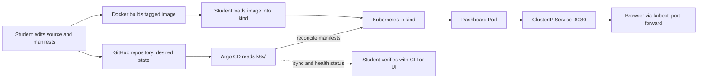

# Architecture and responsibility boundaries

## Components

| Component | Responsibility in this demo |
| --- | --- |
| GitHub repository | Versioned desired state: static source, image recipe, Kubernetes YAML, and Argo CD `Application`. |
| Docker | Packages the dashboard files and Nginx configuration into a tagged container image. It does not deploy or reconcile it. |
| kind | Runs a local Kubernetes cluster in Docker, so the exercise needs no cloud account. |
| Kubernetes | Runs the loaded container as a Pod, checks its HTTP health, and exposes it through a ClusterIP Service. |
| Argo CD | Reads the pushed `k8s/` directory from Git, compares it with the cluster, and reconciles changes using automated sync, prune, and self-heal. |
| Browser | Displays the static dashboard and release metadata. Its status card is explicitly educational metadata, not a cluster health API. |

## Flow

In plain language: Git records the plan; Docker creates the package; kind supplies a local Kubernetes cluster; Argo CD watches Git and applies the Kubernetes plan; Kubernetes runs the package. A browser reaches the Service through a temporary port-forward.

## Reconciliation and image-build boundary

The repository is the source of truth for Kubernetes manifests. Argo CD continuously compares those manifests with cluster resources. Automated sync applies committed changes; `prune` removes managed resources deleted from Git, and `selfHeal` corrects manual drift.

Argo CD **does not build Docker images**. For this kind-local demo, the student builds `gitops-demo-dashboard:v1.0.0` using Docker, loads that exact image into the kind nodes, and then lets Argo CD apply the Deployment that refers to it. The Deployment uses `imagePullPolicy: Never`, so Kubernetes will not silently pull a different image. In the v2 exercise, build and load `:v2.0.0` first; only then commit and push the new desired Deployment image reference. A source-only Git push cannot update a locally loaded image.

The `Application` destination is the in-cluster API endpoint and namespace `gitops-demo`. The `k8s/kustomization.yaml` lists the namespace, Deployment, and Service; resource selectors, ports, target port, and HTTP probes are kept consistent.
